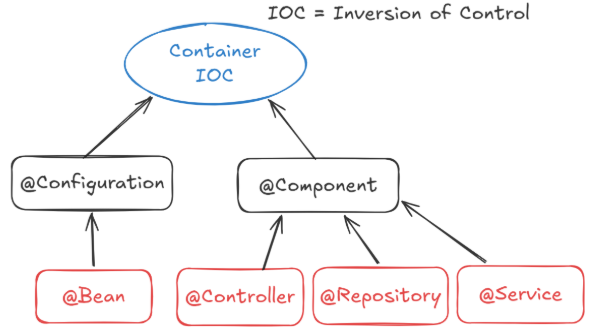

# Anotações da Aula de Spring

## Beans e Configurations
1. Configurations podem ser usadas para, entre outras coisas, configurar parâmetros 
para serviços externos, usuários e senhas para bancos de dados, etc.
2. A anotação é `@Configuration`. Dentro dela pode haver métodos com a anotação `@Bean`.
3. Beans são informações que podem ser chamadas em qualquer parte do sistema.
```
    @Bean(name = "applicationName")
    public String applicationName() {
        return "Sistema da Biblioteca";
    }
```
4. Para usar um bean usamos `@Autowired` e `@Qualifier`:
```
    @Autowired
    @Qualifier("applicationName")
    private String applicationName;

    @GetMapping("/hello")
    public String helloWorld() {
        return applicationName;
    }
```

## Injeção de Dependência


* @Component contém métodos e anotações úteis para a aplicação.
* @Controller é o mesmo controller do modelo MVC.
* @Repository responsável por acesso a dados (é um singleton).
* @Service indica as classes que implementam as regras de negócio.

1. Quando as classes são anotadas, suas instâncias ficam dentro do container e 
podem ser injetadas em partes do código.
2. Para indicar explicitamente quais pacotes devem ser mapeados, usa-se a anotação
`@ComponentScan`. Senão, ele mapeia todo o projeto.

## `application.properties`
1. <a href="https://docs.spring.io/spring-boot/appendix/application-properties/index.html">Lista de propriedades usadas pelo Spring</a> .
2. Também podemos obter valores diretamente do `application.properties`, usando a 
anotação `@Value()`.
3. Podemos ter diferentes `application.properties` para diferentes contextos, como
para desenvolvimento e para produção.
4. Para alternar entre os perfis de contexto, colocamos `spring.profiles.active=[nome]` 
no `application.properties`, alterando nome.
5. A anotação `@Profile()` define qual perfil tem acesso às configurações de uma 
classe `@Configuration`.

## Anotações Customizadas
1. Podemos criar uma anotação customizada.
2. Por exemplo, uma anotação chamada `@Development` que define configurações no 
perfil desenvolvedor.
3. Usamos algumas anotações e o tipo `@interface`.
```
   @Target(ElementType.TYPE)
   @Retention(RetentionPolicy.RUNTIME)
   @Configuration
   @Profile("development")
   public @interface Development {
   }
```